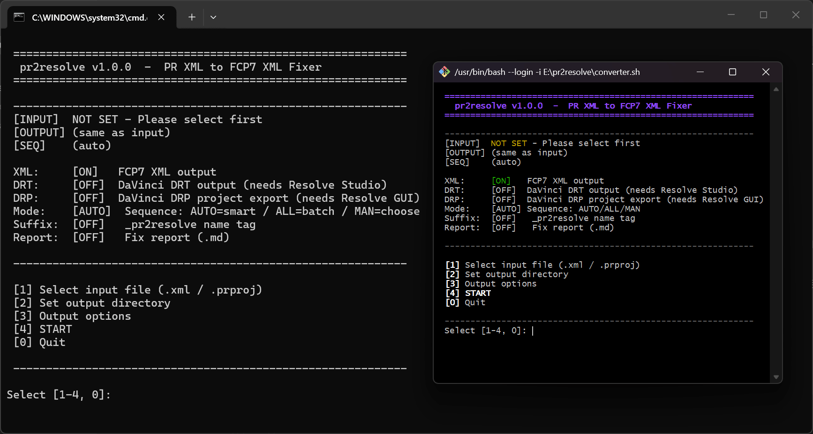

<div align="center">

> **Current Status: Native DRP experimental**
>
> *v1.6.0 — 源参数驱动的时间线设置、Motion 与时间映射*

# pr2resolve — Premiere Pro to DaVinci Resolve Converter

Premiere Pro 转 DaVinci Resolve 的时间线转换器。输出 FCP7 XML、DRT 和 DRP。

[**README in English**](README_EN.md)

参赛材料：[项目说明](docs/contest/submission-brief.md) · [三分钟演示脚本](docs/contest/demo-script-3min.md) · [复现清单](docs/contest/reproducibility-checklist.md)



</div>

---

<!-- omit from toc -->
## 目录

- [快速开始](#快速开始)
  - [Windows](#windows)
  - [macOS](#macos)
  - [Linux](#linux)
  - [源码运行](#源码运行)
- [使用前准备工作](#使用前准备工作)
  - [TUI内操作](#tui内操作)
  - [CLI](#cli)
- [主要功能](#主要功能)
- [项目背景](#项目背景)
- [CLI 参数](#cli-参数)
- [工作原理](#工作原理)
- [修正规则](#修正规则)
- [已知限制](#已知限制)
- [参考](#参考)
- [License](#license)

## 快速开始

普通用户优先下载 [最新 Release](https://github.com/Ersiter/pr2resolve/releases/latest) 中对应平台的压缩包。Release 包自带可执行文件，不需要安装 Python。

### Windows

下载 `pr2resolve-v*-windows-x86_64.zip`，解压后双击 `pr2resolve.exe`，进入交互式 TUI。

### macOS

下载 `pr2resolve-v*-macos-*.tar.gz`，解压后运行：

```bash
tar -xzf pr2resolve-v*-macos-*.tar.gz
chmod +x pr2resolve
./pr2resolve
```

如果 macOS 阻止未签名二进制，请在系统安全设置中允许本次运行，或按你的本机安全策略处理。

### Linux

下载 `pr2resolve-v*-linux-*.tar.gz`，解压后运行：

```bash
tar -xzf pr2resolve-v*-linux-*.tar.gz
chmod +x pr2resolve
./pr2resolve
```

### 源码运行

需要改代码、调试或不使用 Release 包时，再使用源码运行。源码运行需要 Python 3.10+。

Windows、macOS / Linux 均可直接运行 CLI 或 TUI：

```bash
python pr2resolve.py "project.prproj" -o ./output
python tui.py
```

---

## 使用前准备工作

- **Release 包用户**：不需要安装 Python。
- **源码运行用户**：需要 Python 3.10+。Windows 安装时建议勾选 `Add Python to PATH`。
- **纯数据 `.prproj` 转换**：工程中的素材路径、帧率、时码、时长和分辨率直接从 `.prproj` 对象图读取，源素材可以离线或不在本机。
- **原生 DRP 零媒体扫描**：按自动选择、`--sequence` 或 `--all-sequences` 生成一个包含所选序列的 native DRP，不启动 Resolve、不扫描媒体；模板面向 Resolve 21。
- **源参数驱动**：序列帧率、分辨率、时长及注册表从源数据生成；媒体夹按素材路径和序列 UID 保留父子关系，不按显示名称归类。
- **Motion 与时间映射**：按 ParameterID 识别本地化 Motion；XML 保留关键帧并线性近似插值，原始曲线保存在 XML 注释中。native 静态变换、正向恒速及单调 graphdict 变速视频由参数编码；曲线采用分段线性近似，保留全图及剪辑起止，报告末帧对齐残差。
- **验证边界**：本版通过离线结构和原始工程回归，尚未完成 Resolve 导入及视听回归。native 缩放补偿基于模板采用 fit 的假设；不同输入缩放设置下的画面尚未验证。Motion 动画、反向/定格、Bezier 变速、音频变速、非默认锚点、转场、嵌套序列和生成器会明确拒绝；曲线的 native/API 渲染一致性未验证。
- **构建维护者**：官方 Release 二进制使用 Python 3.14、Nuitka、UPX 和平台编译工具链构建。Python 构建依赖见 `requirements-build.txt`。

验证源码环境：

```bash
python --version
```

---

### TUI内操作

```
输入相应数字选择功能：
[1] 选择输入文件 (.xml 或 .prproj)
[2] 设置输出目录
[3] 配置选项 (XML / DRT / DRP / Mode / Suffix / Report)
[4] 开始转换
[0] 退出
```

### CLI

```bash
# 修正 PR 导出的 XML
python pr2resolve.py "input.xml"

# 直接从 .prproj 解析（推荐）
python pr2resolve.py "project.prproj" -o ./output

# 指定序列名
python pr2resolve.py "project.prproj" --sequence "序列 01"

# 导出所有非空序列
python pr2resolve.py "project.prproj" --all-sequences

# DRT 输出（需要达芬奇 Studio 运行中）
python pr2resolve.py "input.xml" --drt

# DRP 后台导出（所有非空序列，headless）
python pr2resolve.py "project.prproj" --drp

# DRP 交互式导出（GUI，工程保持打开）
python pr2resolve.py "project.prproj" --drp-gui

# 纯数据原生 DRP（无需启动 Resolve）
python pr2resolve.py "project.prproj" --native-drp

# 生成修正报告
python pr2resolve.py "input.xml" --report

# 只输出原生工程及报告
python pr2resolve.py "project.prproj" --native-drp --all-sequences --no-xml --report

# 只看不改
python pr2resolve.py "input.xml" --diagnose-only
```

导出的 XML 在达芬奇中导入：

```
File → Import Timeline → Import AAF, EDL, XML... → 选择 .xml 文件
```

---

## 主要功能

**pr2resolve 读取 Premiere Pro 时间线数据，输出 DaVinci Resolve 可直接使用的文件。**

两种输入格式：
- PR 导出的 FCP7 XML (.xml)
- PR 工程文件 (.prproj) — **推荐**，数据最完整

三种输出格式：
- FCP7 XML — 零依赖，所有达芬奇版本均可导入
- native DRP — 主交付路径；无需启动 Resolve，写入时间线、媒体夹、轨道名称、已验证的片段标签颜色枚举及色彩配置
- API DRT/DRP — 兼容兜底路径；native schema 不兼容或导入验证失败时由用户显式选择，需达芬奇 Studio

---

## 项目背景

**源自 Premiere Pro 到 DaVinci Resolve 的实际回批经验及社区广泛反馈。PR 的 FCP7 XML 导出存在以下已知缺陷：**

- **Scale 值全部显示为 100%。**

    PR 中缩放好的画面，XML 中写为 Scale=100%。导入达芬奇后素材尺寸远大于画面，需逐一手动计算修正值。

- **Lumetri 调色信息丢失。**

    XML 中调色数据以 base64 编码存储。达芬奇无法识别，直接跳过，且可能在操作时间线时导致无响应（疑似解析错误致使 I/O 进程堆积）。

- **路径格式不兼容，素材离线。**

    PR 导出的路径格式为 `file://localhost/C%3a/Users/...`，达芬奇不识别此格式，仅能通过 relink 恢复。

**pr2resolve 读取输入后自动修正上述问题，输出干净的 FCP7 XML。**

- **为什么推荐 .prproj 而非导出 XML？**

    PR 自带的 XML 导出是二次加工——先生成删减版 XML 再输出，数据已失真。.prproj 是 PR 原生工程文件（gzip 压缩的 XML），可提供更多时间线、素材和效果上下文。直接提供 .prproj 即可，无需先导出 XML 再修正。

- **时间线状态与调色如何迁移？**

    `.prproj` 读取器按时间线片段身份提取状态与全部 Lumetri ParameterID。native DRP 写入片段标签颜色、空轨拓扑、轨道名称、直接媒体夹层级和时间线 marker。Lumetri 会被检测，但 native grade 未验证，不写入或嵌入 cube LUT。

| 状态 | native DRP | API DRT / DRP |
|---|---|---|
| 片段标签颜色 | 16 档预设映射；自定义 RGB 未映射 | 同一预设映射，按轨道和片段位置匹配 |
| 独立轨道颜色、旗标 | 未实现 | 未实现；标签颜色不等于旗标 |
| 时间线 marker | 写入位置、名称、注释、时长；颜色暂用 Blue | 补建缺失 marker；冲突、拒绝写入会告警 |
| 序列 In/Out | 未写入，显式状态会告警 | 成对设置、明确未设置时清除；单边状态告警 |
| 轨道名称、静音、锁定 | 写入自定义名称及锁定/禁用位；离线验证 | 使用相同源状态调用官方 API，失败会告警 |
| 工作区、轨道/源片段 marker | 工作区与已提取轨道 marker 保留源记录，未应用 | 未应用 |

marker 的源颜色索引保留在 XML 状态注释；有索引时会提示颜色未映射。上述写入经过离线测试，仍需在闲置的 Resolve 环境中验证可见结果；详见 [格式依据与验收边界](NATIVE_FORMAT.md)。

---

## CLI 参数

| 参数 | 类型 | 说明 |
|------|------|------|
| `input` | Path | 输入文件 (.xml 或 .prproj) |
| `-o`, `--output` | Path | 输出目录（默认：与输入文件同目录） |
| `--report` | flag | 生成修正报告 (.md) |
| `--drt` | flag | 生成 DRT 输出（需达芬奇 Studio） |
| `--drp` | flag/path | 后台导出 DRP（所有非空序列） |
| `--drp-gui` | flag/path | 交互式导出 DRP（所有非空序列） |
| `--native-drp` | flag/path | 纯数据 native DRP（无需 Resolve；一个工程包含所选时间线，全部导出需配合 --all-sequences） |
| `--all-sequences` | flag | 导出 .prproj 中全部非空序列 |
| `--sequence` | str | 指定 .prproj 中的序列名 |
| `--no-suffix` | flag | 输出文件名不加 `_pr2resolve` 后缀 |
| `--no-xml` | flag | 跳过 FCP7 XML 输出（与 --drt、--drp 或 --native-drp 配合时） |
| `--diagnose-only` | flag | 仅诊断，不修正 |
| `--version` | flag | 显示版本号 |

---

## 工作原理

```
输入 (.xml 或 .prproj)
    │
    ├─ XML → ElementTree 结构化解析
    ├─ .prproj → gzip 解压 → ObjectID 图遍历
    │
    ▼
扫描 21 项已知问题 → 按严重级别自动修正 → 23 项合规验证
    │
    ▼
输出:
    ├─ output.xml   ← 修正后的 FCP7 XML（默认输出）
    ├─ output.md    ← 修正报告（--report 时）
    ├─ output.drt   ← 达芬奇原生时间线（--drt 时，需达芬奇运行）
    └─ output.drp   ← 达芬奇工程导出（--drp / --drp-gui 时）
```

---

## 修正规则

| 级别 | 规则 | 说明 |
|------|------|------|
| C0 | version | `xmeml version="4"` → `"5"` |
| C1-C2 | format | 补全 video/audio `<format>` |
| C3-C4 | rate | 补全 `<ntsc>` / `<timebase>` |
| C5 | pathurl | `file://localhost/...` → `file:///...` |
| C6 | media 顺序 | video 移到 audio 前面 |
| M0 | Lumetri | XML: 删除；DRT/API DRP: 静态三参数近似 CDL；native DRP: 仅检测，未验证 native grade |
| M1-M2 | clipid/track | 补全 `<masterclipid>` / `<sourcetrack>` |
| M4 | link | 同源素材生成 `<link>` |
| M5 | file details | 补全 `<file>` 的 samplecharacteristics |
| M6 | 元素顺序 | clipitem 子元素按 FCP7 规范排序 |
| M7 | Scale | 源分辨率 / 时间线分辨率 = fit scale |
| N1-N7 | 细节 | timecode / 浮点精度 / 帧率一致性 / displayformat 等 |

所有规则自动应用，不提供开关。这些修正是必需的——不修正将导致导入失败或画面错误。

---

## 已知限制

1. **PR 文字标题** — 导入达芬奇后常为空。FCP7 XML 自身限制，无法修正。
2. **嵌套序列** — 经常被展平或导入失败。
3. **素材移动** — XML 存储绝对路径，素材搬移后需在达芬奇 relink。
4. **达芬奇导入设置** — 建议取消 "Use sizing information"，避免双重缩放。
5. **免费版达芬奇** — 本项目的 DRT/DRP 路径按 DaVinci Resolve Studio 验证；免费版不作为支持目标。XML 不受影响。
6. **Lumetri 空间与时间运算** — 3D LUT 无法表达降噪、锐化、模糊、暗角和关键帧。native DRP 会检测但不伪装为等价转换。
7. **色彩空间词汇差异** — native DRP 按模板映射 Rec.709、ACEScct 与 Rec.2100 HLG 配置；不同 HDR 项目与输入色彩空间仍需实机核对。API DRP 还会按素材路径设置已知输入色彩空间。
8. **原生工程仍需导入验收** — 序列注册、媒体引用、marker 和时映射的离线检查不能证明画面、音频、Fairlight 多音轨及切换稳定性。marker 和源起始时码的可见应用仍未验证；原生 In/Out、轨道静音/锁定和旗标尚未应用。`--report` 不依赖 XML 输出，导出拒绝后也可查看已生成的报告。

原生字段依据、行业实现比较和后续验收方法见 [转换实现说明](NATIVE_FORMAT.md)。

---

## 参考

- [PRPROJ-READER](https://github.com/sergeiventurinov/PRPROJ-READER) — .prproj 格式逆向
- [prproj_downgrade](https://github.com/snorkem/prproj_downgrade) — .prproj 版本降级工具
- [ppro-scripting](https://ppro-scripting.docsforadobe.dev) — Adobe 对象模型文档
- [DaVinci Resolve Scripting API](https://resolvedevdoc.readthedocs.io/) — 达芬奇 API 参考
- [DaVinci Resolve MCP](https://github.com/samuelgursky/davinci-resolve-mcp) — 达芬奇 MCP 开源项目

---

## License

[MIT LICENSE](./LICENSE)
